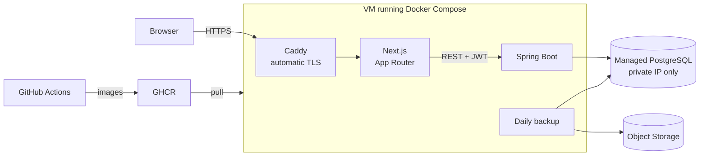

# Gastro Guide

A clinical management system for gastroenterology and hepatology practices: electronic health records, scheduling, medical documents and patient self-booking.

It is **in production and in its pilot phase**, in real use at a medical practice since September 2026. I designed, built and deployed the whole system: backend, frontend, database, infrastructure and CI/CD.

    

> The product serves Brazilian physicians, so its interface, API messages and code comments are in Portuguese.

## About this repository

This is a public portfolio copy. The production system lives in a private repository with the full development history.

In this copy, the history was condensed and client and infrastructure data were removed. The patient guidance texts were replaced with an example, and the CI/CD pipeline stayed in the private repository. Some code comments still mention the internal prototype and documentation, which are not included here.

The code is available for reading and evaluation, with no license for reuse. The clinical content is not medical advice.

## Features

- **Electronic health records:** 13 diseases plus general consultation templates, with dynamic forms, a chronological history, automatic draft saving and printed records that follow Brazilian Federal Council of Medicine (CFM) rules.
- **Clinical scores:** 67 calculators, such as Child-Pugh, MELD, FIB-4 and Mayo. Results can be attached to the record.
- **Scheduling:** availability windows, time blocks, durations per visit type, overbooking, rescheduling and conflict detection based on overlapping time ranges.
- **Public patient link:** registration and self-booking without a login, through a single-use link.
- **Medical documents:** certificates, patient guidance and exam orders, with ICD-10 search and a catalog of 650 exams. Issued documents cannot be changed.
- **Digital signatures:** physicians attach a PDF signed with an ICP-Brasil or gov.br certificate, and the backend checks that the signature matches the document.
- **Accounts and roles:** each physician sees only their own data. Secretaries can access scheduling and patient registration, but not clinical data.
- **Dashboard:** practice metrics calculated from real data.

## Production architecture



The backend and frontend expose no ports: only Caddy talks to the internet. The VM never compiles anything. CI runs the tests, publishes one image per commit and deploys over SSH, so a rollback just points to an earlier commit's tag. Hosting is in São Paulo, chosen after comparing cost and latency, because each health record screen makes several API calls.

## Technical decisions

### Diseases as configuration, not features

Each disease is a configuration on top of a generic engine, with no table or hardcoded form of its own. The backend describes fields, types, options and visibility rules, and the frontend builds the screen from that description. The data is stored as JSONB.

The project started with two pilot diseases, one simple and one complex, to validate both extremes. The other 11 were added almost entirely as configuration, with a few targeted extensions to the engine.

See [`DiseaseRegistry.java`](backend/src/main/java/com/gastroguide/medicalrecord/DiseaseRegistry.java) and [`dynamic-form-field.tsx`](frontend/src/components/dynamic-form-field.tsx).

### Immutable clinical records

Health records have legal value. When a record is created, the system copies the disease header and freezes the physician's license details used for that record. Editing the header or profile later does not rewrite history. Issued documents follow the same rule, and the API offers no way to edit or delete them.

### Authentication

- 15-minute JWT access tokens and 30-day opaque refresh tokens, stored only as hashes.
- Refresh tokens rotate on every use. If a revoked token reappears, all of that user's sessions are terminated.
- Tokens live in httpOnly cookies, out of reach of browser JavaScript.
- Rate limiting by IP and email, with error messages that do not reveal whether an account exists.

### The public link as an attack surface

This is the only area of the system without a login, and the link circulates over WhatsApp. At a specialist practice, knowing that someone is a patient is already health information. The safeguards reflect that:

- Single-use tokens, stored as hashes, with a limited lifetime.
- Identification by CPF (the Brazilian taxpayer ID) **and** date of birth. A CPF alone neither reveals nor changes anything.
- A dedicated rate limit for identification, with the CPF sent by POST so it stays out of logs and browser history.
- Clinical data stays out of this flow.
- Registration and booking run in one transaction, so a slot taken at the last moment does not leave a patient without an appointment.

### Scheduling

Slot generation is a pure function ([`SlotGenerator`](backend/src/main/java/com/gastroguide/availability/SlotGenerator.java)), tested without a database or mocks. Availability is declared in local time and converted with an explicit time zone. A partial unique index in Postgres protects against simultaneous bookings at the same instant.

### Signature verification

Integrating with each certificate authority would require a contract and credentials for each one. This approach covers all of them: the printed document carries a verification code, the physician signs the PDF in their own signing tool and attaches the file. Using PDFBox and BouncyCastle, the backend checks the code, the integrity of each signature and the certificate details.

The chain up to the ICP-Brasil root is not validated here. The screen sends users to the official government validator for that check.

## Stack

| Layer | Technologies |
|---|---|
| Backend | Java 21, Spring Boot 3.4, Spring Security, JPA, Flyway (31 migrations), PDFBox, BouncyCastle |
| Frontend | Next.js 16 (App Router, Server Actions), React 19, TypeScript, Tailwind CSS 4, shadcn/ui |
| Data | PostgreSQL 16, with JSONB for configurable clinical data |
| Infrastructure | Docker Compose, Caddy, GitHub Actions, GHCR, Magalu Cloud (VM, managed PostgreSQL and Object Storage) |
| Testing | JUnit 5, MockMvc, Testcontainers |

## Testing and quality

The backend has **178 tests**. Integration tests start a real PostgreSQL instance with Testcontainers and cover isolation between physicians, authentication, role permissions, the form engine, scheduling and the public link.

In the private repository, CI runs this suite, a typecheck, the production build, an audit of production dependencies and the image builds. The calculator formulas, which live in the frontend, do not have automated tests yet.

## Running locally

You need Docker. From the project root:

```bash
docker compose up
```

The frontend runs at http://localhost:3000 and the API at http://localhost:8080. Create a physician account on the sign-up screen.

To run the backend tests, with JDK 21 and Docker running:

```bash
cd backend && ./mvnw test
```

## Project structure

```text
backend/    Spring Boot API, organized by domain, and Flyway migrations
frontend/   Next.js application
deploy/     Caddy, backup and production environment template
docker-compose.yml             Development environment
docker-compose.prod.yml        Production stack
docker-compose.monitoring.yml  Metrics collection
```

---

Built by **Lucas Martinez Domingues**.
